# iScreva: the perfect soul for your iWriterDeck

**iScreva** is a plain-text editor that runs on pretty much any browser version from 2012 to today. It was designed specifically for the 4th-generation iPod touch, but it works well on anything with a screen and a keyboard.

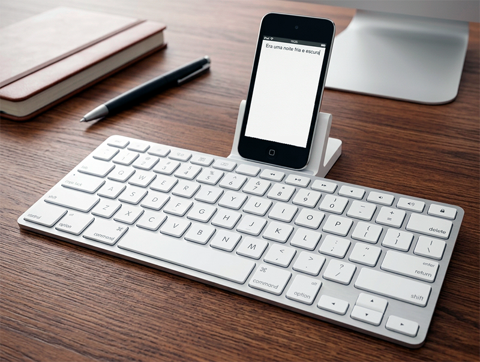

The philosophy is simple: you write, then download or print the file to include it in your real project — another editor, a repository, whatever it may be. Whatever is left over can be deleted. It is not a place to keep anything; it is a place to materialize the idea before it escapes. There is a password and a _captcha_ to hide your work from prying eyes, but nothing very sophisticated. The obvious advantage is that you can continue your work wherever you are, with whatever you have at hand.

**iScreva** fits into the movement of repurposing obsolete smartphones and tablets by attaching a physical keyboard to them to create a _distraction-free_ typewriter. In my case, an old iPod connected to an equally old Apple keyboard dock. A second-hand set of these costs a fraction of the price of a _Freewrite_.

Most people who build _writer decks_ get there through hardware — soldering, 3D-printing cases, picking expensive mechanical keyboards. I got there through software: a lean editor that doesn't depend on modern features. Modest, but functional and, I hope, even elegant.

## Customizable appearance

You can choose among ten key styles, endless text and background colors, and five different fonts.

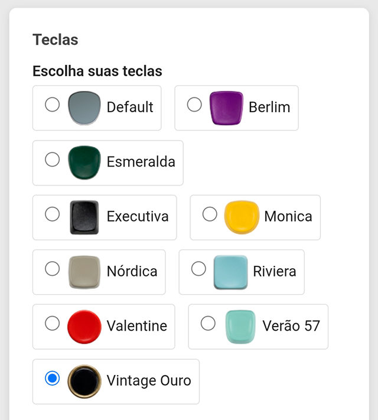

Here are some sample screens (screenshots from the iPod):

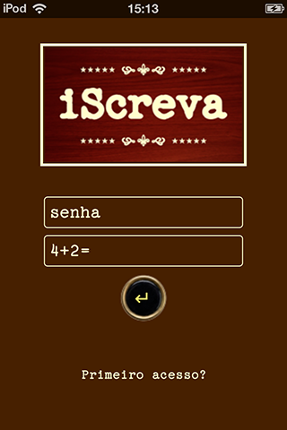
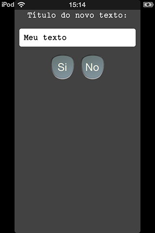
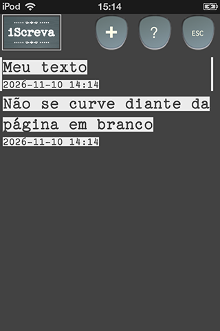
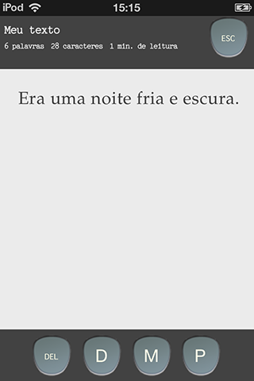
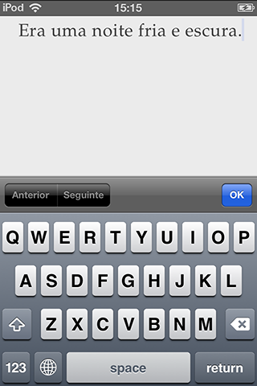
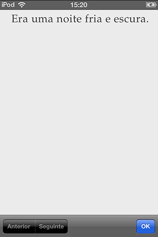
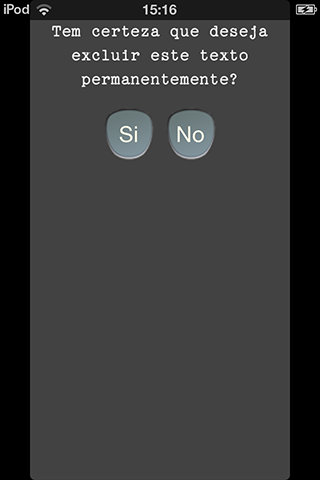
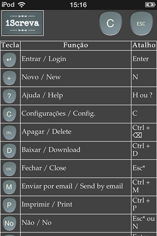
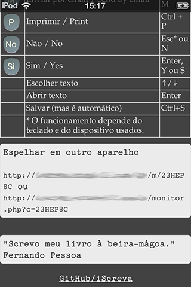

It's perfect for anyone with an iPad, an iPod touch, an old Android, a laptop, or anything with a browser and a screen who wants a way to write without distractions and without spending anything. All you need is a minimal amount of space on a web server (it can be free, as long as it runs _PHP 7+_ and has the basic features).

## How to install

Put the **iScreva** folder in your server's public directory and, for extra security, give it a different name. Open `index.php`. On first access, click the "First access?" _link_ and a password will be offered. Use it to log in, then go to Settings to change it (minimum of 8 characters).

On the first run, four files will be created automatically: `iscreva_master_db.php`, `iscreva_master_xxxxxx.db`, `iscreva_conta_xxxxxx.db` and `iscreva_live_xxxxxx.db`.

### Closing registration

After creating your login, if you want to prevent other users from being created, open `comum.php` and change the first option to `false`:

```php
define('PERMITIR_CADASTRO', false);
```

### Extra security (optional): block direct access to the .db files

**Nginx** — put these rules inside the `server { }` block, before `location ~ \.php$`:

```nginx
location ~* \.(db|db-journal|db-wal|db-shm)$ { deny all; }
location ~* \.db\.tmp\.[a-f0-9]+$            { deny all; }
location = /iscreva_master_db.php            { deny all; }
```

Then validate and reload:

```bash
sudo nginx -t && sudo systemctl reload nginx
```

**Apache** — in `.htaccess` (requires Apache 2.4+):

```apache
<FilesMatch "\.(db|db-journal|db-wal|db-shm)$|\.db\.tmp\.[a-f0-9]+$|^iscreva_master_db\.php$">
    Require all denied
</FilesMatch>
```

## Keyboard shortcuts

**In the text list**

- `↑` / `↓` — choose the text
- `Enter` — open the selected text
- `N` — new text
- `H` or `?` — help
- `C` — settings
- `Esc` — logout\*

**In the editor**

- `Ctrl+S` (`Cmd+S` on Mac) — save
- `Ctrl+D` — download
- `Ctrl+M` — send by email
- `Ctrl+P` — print
- `Ctrl+⌫` — delete the text
- `Esc` — close the editor\*

**In confirmation prompts**

- `S` or `Y` — yes
- `N` — no
- `Esc` — cancel\*

\* The exact behavior of the `Esc` key may depend on the system you are using.

## Using an external monitor

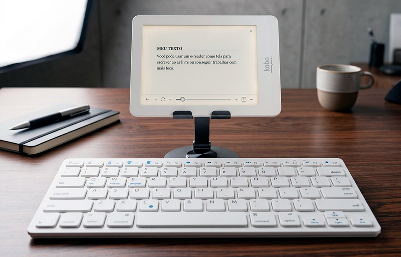

You can use a second device — an e-reader, an old tablet, an external monitor — to view the text you are writing. The editor stays on the keyboard and the main device; the second one only displays the text. It's a particularly nice feature with an e-reader when you write on a smartphone full of notifications.

To enable it, go to **Help** and open, on the other device, the address shown under "Mirror on another device". It comes in the short form `https://your-server/m/ABCD234` or the full form `https://your-server/monitor.php?c=ABCD234`.

**Note:** the short URL depends on the rule in the `.htaccess` that ships with the project. If the server is **Nginx**, add the following to the `server { }` block:

```nginx
rewrite ^/m/([A-Za-z0-9]+)/?$ /monitor.php?c=$1 last;
```
