[](README.en.md)
[](README.es.md)
[](README.eo.md)
[](README.pt-br.md)

***Tradukita el la portugala***

# iScreva: la perfekta animo por via iWriterDeck

**iScreva** estas simpla tekstredaktilo, kiu funkcias en preskaŭ ajna retumila versio de 2012 ĝis hodiaŭ. Ĝi naskiĝis speciale por la kvara generacio de iPod touch, sed bone funkcias sur io ajn, kio havas ekranon kaj klavaron.

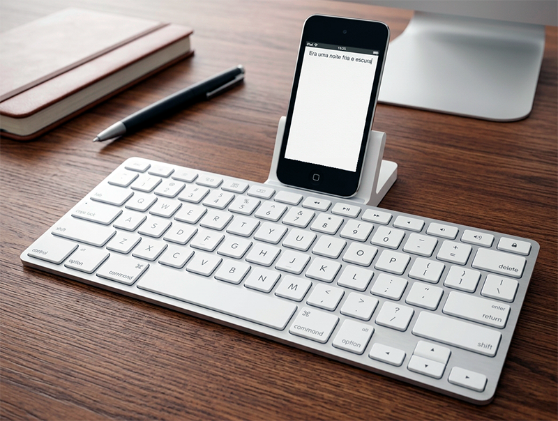

La filozofio estas simpla: vi skribas, poste elŝutas aŭ printas la dosieron por enmeti ĝin en vian veran projekton — alia redaktilo, deponejo, kio ajn. Kio restas povas esti forigita. Ĝi ne estas loko por konservi ion; ĝi estas loko por materialigi la ideon antaŭ ol ĝi forkuros. Estas pasvorto kaj _captcha_ por kaŝi vian laboron de scivolemaj okuloj, sed nenio tre rafinita. La evidenta avantaĝo estas, ke vi povas daŭrigi la laboron kie ajn vi estas, per kio ajn vi havas ĉemane.

**iScreva** aliĝas al la movado por reuzi malnoviĝintajn saĝtelefonojn kaj tabulkomputilojn, aldonante al ili fizikan klavaron por krei _distraction-free_ skribmaŝinon. En mia kazo, malnova iPod konektita al same malnova klavara doko de Apple. Duaranga aro de ĉi tiuj kostas frakcion de la prezo de _Freewrite_.

Plej multaj homoj, kiuj konstruas _writer decks_, alvenas per la aparataro — lutante, presante loĝejojn per 3D, elektante multekostajn mekanikajn klavarojn. Mi alvenis per la programaro: modesta redaktilo, kiu ne dependas de modernaj trajtoj. Humila, sed funkcia kaj, mi esperas, eĉ eleganta.

## Adaptebla aspekto

Eblas elekti inter dek modeloj de klavoj, senfinaj koloroj por teksto kaj fono, kaj kvin malsamaj tiparoj.

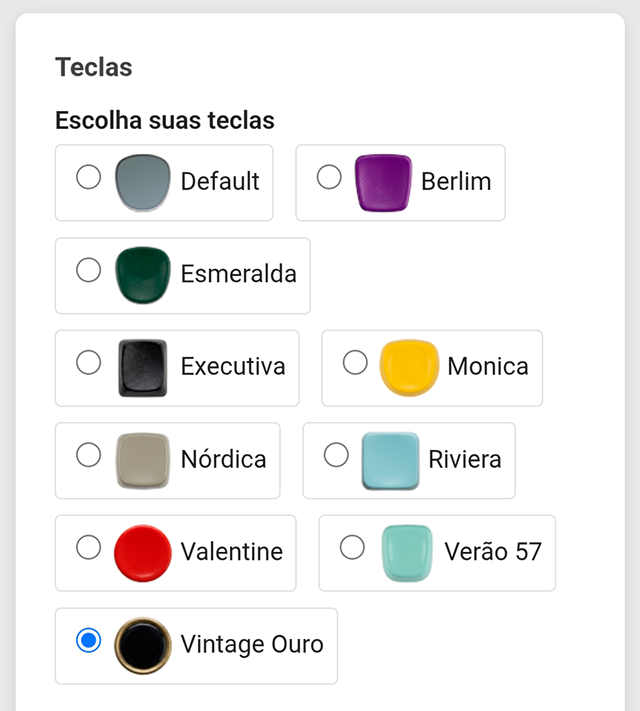

Jen kelkaj ekzemplaj ekranoj (ekrankopioj de la iPod):

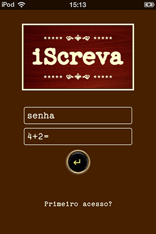
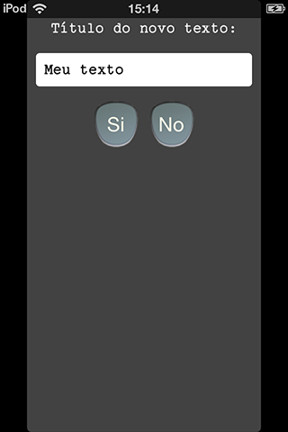
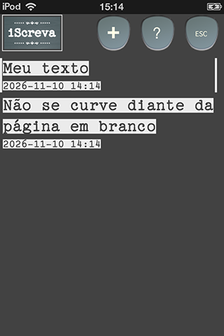
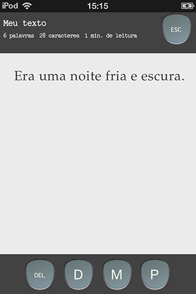
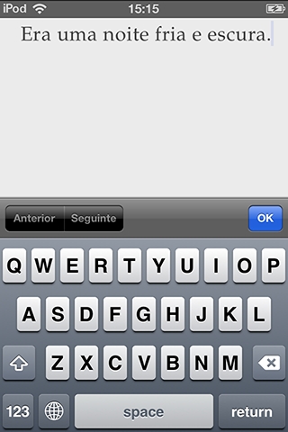
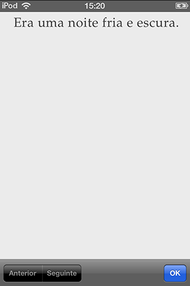
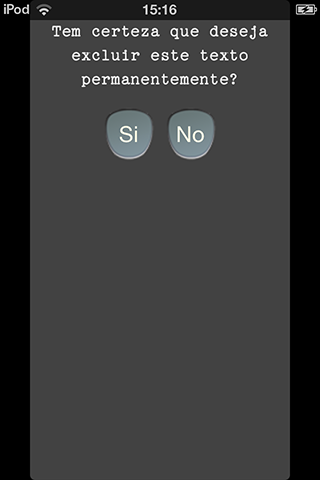
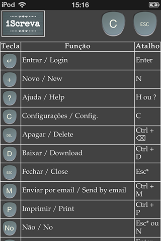
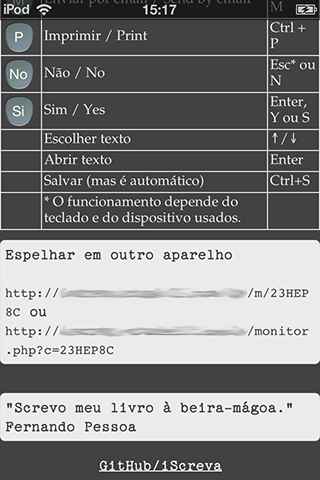

Ĝi estas perfekta por iu, kiu havas iPad, iPod touch, malnovan Android, tekkomputilon aŭ ion ajn kun retumilo kaj ekrano kaj volas alternativon por skribi sen distro kaj sen elspezi ion. Sufiĉas minimuma spaco sur reteja servilo (ĝi povas esti senpaga, kondiĉe ke ĝi rulu _PHP 7+_ kaj havu la bazajn rimedojn).

## Kiel instali

Metu la dosierujon de **iScreva** en la publikan dosierujon de via servilo kaj, por pli da sekureco, donu al ĝi alian nomon. Malfermu `index.php`. Ĉe la unua aliro, klaku la ligilon "Unua aliro?" kaj pasvorto estos proponita. Uzu ĝin por ensaluti, poste iru al Agordoj por ŝanĝi ĝin (minimumo de 8 signoj).

Ĉe la unua rulado, kvar dosieroj estos kreitaj aŭtomate: `iscreva_master_db.php`, `iscreva_master_xxxxxx.db`, `iscreva_conta_xxxxxx.db` kaj `iscreva_live_xxxxxx.db`.

### Fermi la aliĝon

Post krei vian saluton, se vi volas malhelpi la kreadon de aliaj uzantoj, malfermu `comum.php` kaj ŝanĝu la unuan opcion al `false`:

```php
define('PERMITIR_CADASTRO', false);
```

### Ekstra sekureco (nedeviga): bloki rektan aliron al la .db-dosieroj

**Nginx** — metu ĉi tiujn regulojn ene de la bloko `server { }`, antaŭ `location ~ \.php$`:

```nginx
location ~* \.(db|db-journal|db-wal|db-shm)$ { deny all; }
location ~* \.db\.tmp\.[a-f0-9]+$            { deny all; }
location = /iscreva_master_db.php            { deny all; }
```

Poste validigu kaj reŝargu:

```bash
sudo nginx -t && sudo systemctl reload nginx
```

**Apache** — en `.htaccess` (postulas Apache 2.4+):

```apache
<FilesMatch "\.(db|db-journal|db-wal|db-shm)$|\.db\.tmp\.[a-f0-9]+$|^iscreva_master_db\.php$">
    Require all denied
</FilesMatch>
```

## Klavaraj ŝparvojoj

**En la teksta listo**

- `↑` / `↓` — elekti la tekston
- `Enter` — malfermi la elektitan tekston
- `N` — nova teksto
- `H` aŭ `?` — helppagino
- `C` — agordoj
- `Esc` — elsaluti\*

**En la redaktilo**

- `Ctrl+S` (`Cmd+S` sur Mac) — konservi
- `Ctrl+D` — elŝuti
- `Ctrl+M` — sendi per retpoŝto
- `Ctrl+P` — printi
- `Ctrl+⌫` — forigi la tekston
- `Esc` — fermi la redaktilon\*

**En la konfirmaj avertoj**

- `S` aŭ `Y` — jes
- `N` — ne
- `Esc` — nuligi\*

\* La ekzakta konduto de la klavo `Esc` povas dependi de la sistemo, kiun vi uzas.

## Uzi eksteran ekranon

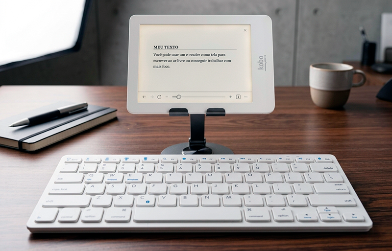

Vi povas uzi duan aparaton — legilon, malnovan tabulkomputilon, eksteran ekranon — por vidi la tekston, kiun vi skribas. La redaktilo restas sur la klavaro kaj la ĉefa aparato; la dua nur montras la tekston. Ĝi estas aparte interesa funkcio kun legilo, kiam vi skribas sur saĝtelefono plena de sciigoj.

Por ŝalti ĝin, iru al **Helpo** kaj malfermu, sur la alia aparato, la adreson montratan sub "Speguli sur alia aparato". Ĝi venas en la mallonga formo `https://via-servilo/m/ABCD234` aŭ la plena formo `https://via-servilo/monitor.php?c=ABCD234`.

**Noto:** la mallonga URL dependas de la regulo en la `.htaccess`, kiu akompanas la projekton. Se la servilo estas **Nginx**, aldonu al la bloko `server { }`:

```nginx
rewrite ^/m/([A-Za-z0-9]+)/?$ /monitor.php?c=$1 last;
```