[](README.en.md)
[](README.es.md)
[](README.eo.md)
[](README.pt-br.md)

***Traducido del portugués***

# iScreva: el alma perfecta para tu iWriterDeck

**iScreva** es un editor de texto plano que funciona en prácticamente cualquier versión de navegador desde 2012 hasta hoy. Nació pensado específicamente para el iPod touch de cuarta generación, pero funciona bien en cualquier cosa con una pantalla y un teclado.

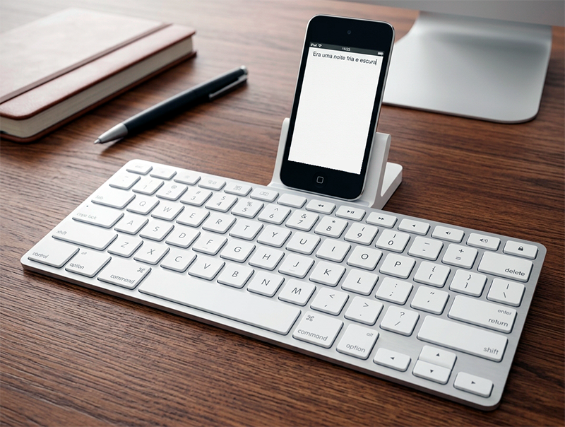

La filosofía es simple: tú escribes y después descargas o imprimes el archivo para incluirlo en tu proyecto real — otro editor, un repositorio, lo que sea. Lo que sobra se puede borrar. No es un lugar para guardar nada; es un lugar para materializar la idea antes de que escape. Hay una contraseña y un _captcha_ para esconder tu trabajo de miradas ajenas, pero nada muy sofisticado. La ventaja evidente es que puedes continuar el trabajo donde estés, con lo que tengas a mano.

**iScreva** se suma a la corriente de reutilizar smartphones y tablets obsoletos, acoplándoles un teclado físico para crear una máquina de escribir _distraction-free_. En mi caso, un iPod viejo conectado a un dock de teclado de Apple, también viejo. Un conjunto de estos, de segunda mano, cuesta una fracción del precio de un _Freewrite_.

La mayoría de quienes construyen _writer decks_ llegan por el hardware — soldando, imprimiendo carcasas en 3D, eligiendo teclados mecánicos caros. Yo llegué por el software: un editor enjuto, que no depende de recursos modernos. Modesto, pero funcional y hasta, espero, elegante.

## Apariencia personalizable

Es posible elegir entre diez modelos de teclas, colores infinitos para el texto y el fondo, y cinco fuentes diferentes.

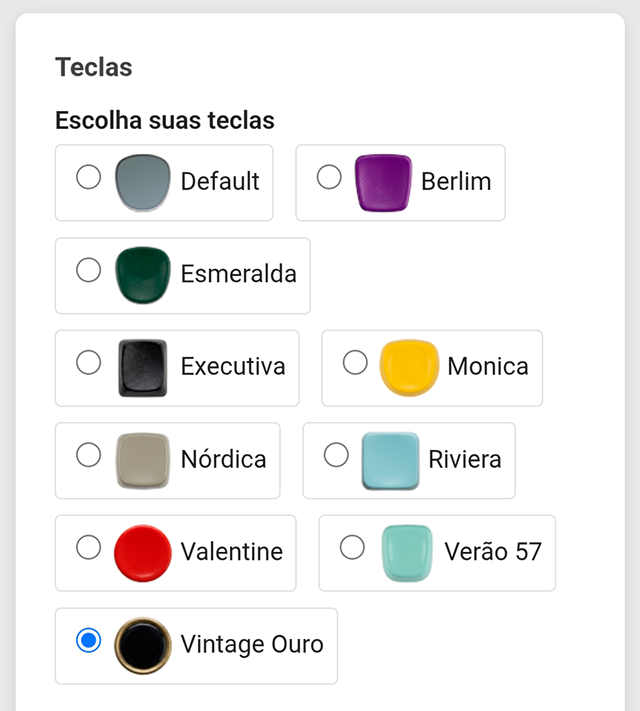

Aquí algunas pantallas de ejemplo (capturas del iPod):

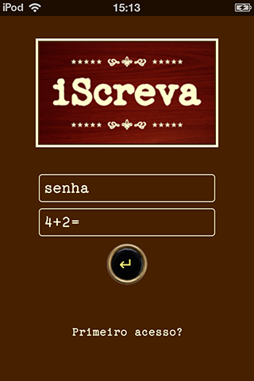
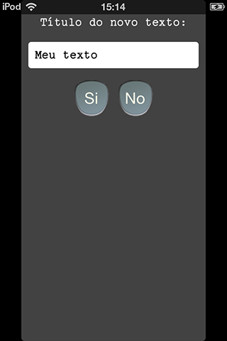
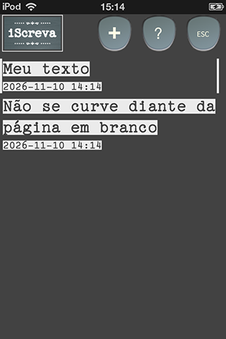
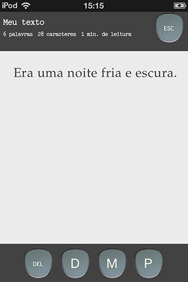
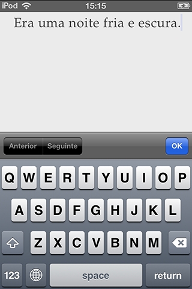
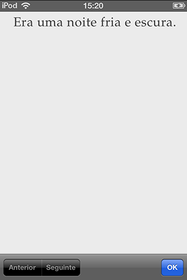
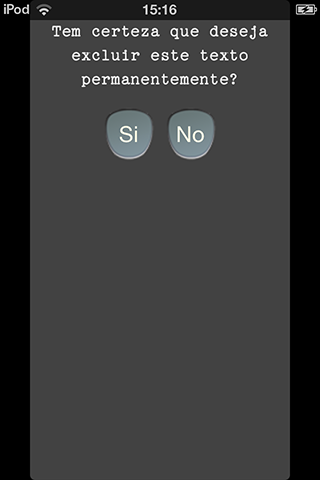
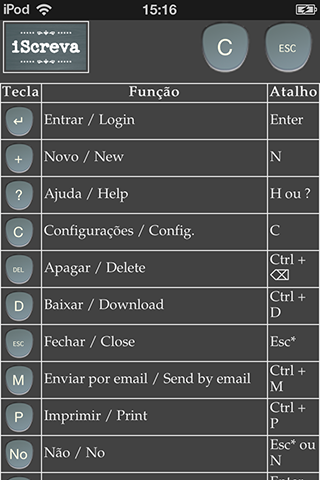
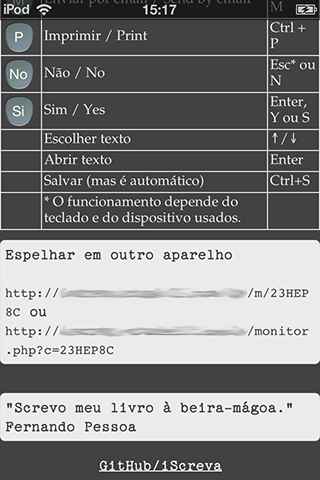

Es perfecto para quien tiene un iPad, un iPod touch, un Android viejo, un portátil o cualquier cosa con navegador y pantalla y quiere una alternativa para escribir sin distracciones y sin gastar nada. Basta con un espacio mínimo en un servidor web (puede ser gratuito, siempre que corra _PHP 7+_ y tenga los recursos básicos).

## Cómo instalar

Coloca la carpeta de **iScreva** en el directorio público de tu servidor y, por seguridad, dale otro nombre. Accede al `index.php`. En el primer acceso, haz clic en el enlace «¿Primer acceso?» y se te ofrecerá una contraseña. Úsala para entrar y ve a Configuración para cambiarla (mínimo de 8 caracteres).

En la primera ejecución se crearán automáticamente cuatro archivos: `iscreva_master_db.php`, `iscreva_master_xxxxxx.db`, `iscreva_conta_xxxxxx.db` e `iscreva_live_xxxxxx.db`.

### Cerrar el registro

Después de crear tu cuenta, si quieres impedir la creación de otros usuarios, abre `comum.php` y cambia la primera opción a `false`:

```php
define('PERMITIR_CADASTRO', false);
```

### Seguridad extra (opcional): bloquear el acceso directo a los .db

**Nginx** — coloca estas reglas dentro del bloque `server { }`, antes de `location ~ \.php$`:

```nginx
location ~* \.(db|db-journal|db-wal|db-shm)$ { deny all; }
location ~* \.db\.tmp\.[a-f0-9]+$            { deny all; }
location = /iscreva_master_db.php            { deny all; }
```

Luego valida y recarga:

```bash
sudo nginx -t && sudo systemctl reload nginx
```

**Apache** — en `.htaccess` (requiere Apache 2.4+):

```apache
<FilesMatch "\.(db|db-journal|db-wal|db-shm)$|\.db\.tmp\.[a-f0-9]+$|^iscreva_master_db\.php$">
    Require all denied
</FilesMatch>
```

## Atajos de teclado

**En la lista de textos**

- `↑` / `↓` — elegir el texto
- `Enter` — abrir el texto elegido
- `N` — nuevo texto
- `H` o `?` — ayuda
- `C` — configuración
- `Esc` — cerrar sesión\*

**En el editor**

- `Ctrl+S` (`Cmd+S` en Mac) — guardar
- `Ctrl+D` — descargar
- `Ctrl+M` — enviar por correo
- `Ctrl+P` — imprimir
- `Ctrl+⌫` — borrar el texto
- `Esc` — cerrar el editor\*

**En los avisos de confirmación**

- `S` o `Y` — sí
- `N` — no
- `Esc` — cancelar\*

\* El comportamiento exacto de la tecla `Esc` puede depender del sistema que estés usando.

## Usar un monitor externo

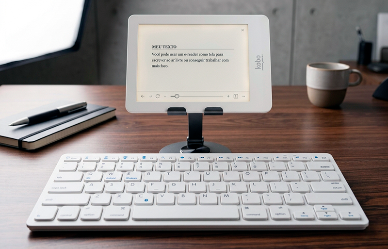

Puedes usar un segundo dispositivo — un e-reader, una tablet vieja, un monitor externo — para ver el texto que estás escribiendo. El editor se queda en el teclado y el dispositivo principal; el segundo solo muestra el texto. Es un recurso particularmente interesante con un e-reader cuando escribes en un smartphone lleno de notificaciones.

Para activarlo, ve a **Ayuda** y abre, en el otro dispositivo, la dirección que aparece en «Espejar en otro dispositivo». Tiene la forma corta `https://tu-servidor/m/ABCD234` o la forma completa `https://tu-servidor/monitor.php?c=ABCD234`.

**Nota:** la URL corta depende de la regla del `.htaccess` que acompaña al proyecto. Si el servidor es **Nginx**, añade al bloque `server { }`:

```nginx
rewrite ^/m/([A-Za-z0-9]+)/?$ /monitor.php?c=$1 last;
```