# iScreva: a alma perfeita para o seu iWriterDeck

**iScreva** é um editor de texto puro que funciona em praticamente qualquer navegador, de 2012 até hoje. Nasceu pensado especificamente para o iPod touch de quarta geração, mas roda bem em qualquer coisa com tela e navegador web.

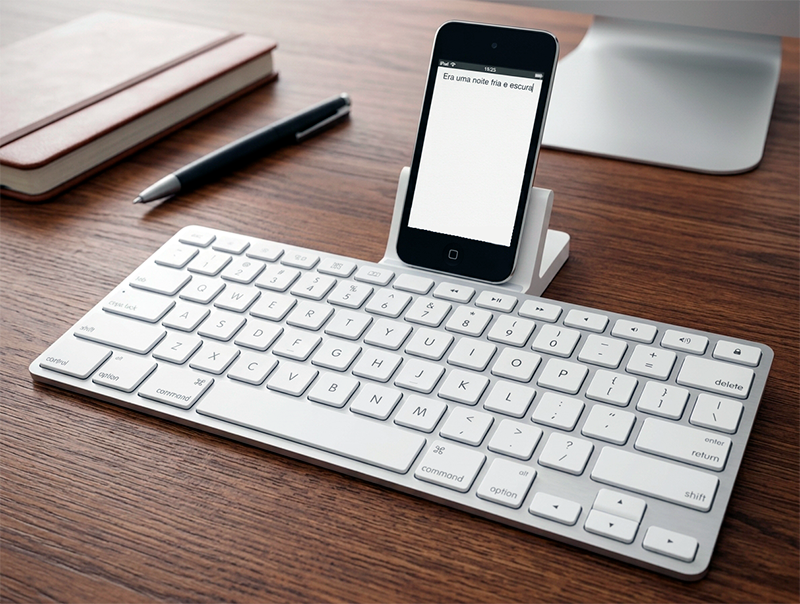

A filosofia é simples: você escreve e depois baixa ou imprime o arquivo para incluí-lo no seu projeto de verdade — outro editor, um repositório, o que for. O que sobra pode ser apagado. Não é um lugar para guardar nada; é um lugar para materializar a ideia antes que ela escape. Há uma senha e um _captcha_ para esconder o seu trabalho de olhos alheios, mas nada muito sofisticado. A vantagem evidente é que você continua o trabalho onde estiver, com o que tiver à mão.

O **iScreva** se encaixa na corrente de reaproveitar smartphones e tablets obsoletos, acoplando-lhes um teclado físico para criar uma máquina de escrever _distraction free_. No meu caso, um iPod antigo conectado a um dock de teclado da Apple, também antigo. Um conjunto desses, de segunda mão, custa uma fração do preço de um _Freewrite_.

A maioria das pessoas que constrói _writer decks_ chega lá pelo hardware — soldando, imprimindo gabinetes em 3D, escolhendo teclados mecânicos caros. Eu cheguei pelo software: um editor enxuto, que não depende de recursos modernos. Modesto, mas funcional e até, espero, elegante.

## Aparência customizável

É possível escolher entre dez modelos de teclas, infinitas cores para texto e fundo e cinco fontes diferentes.

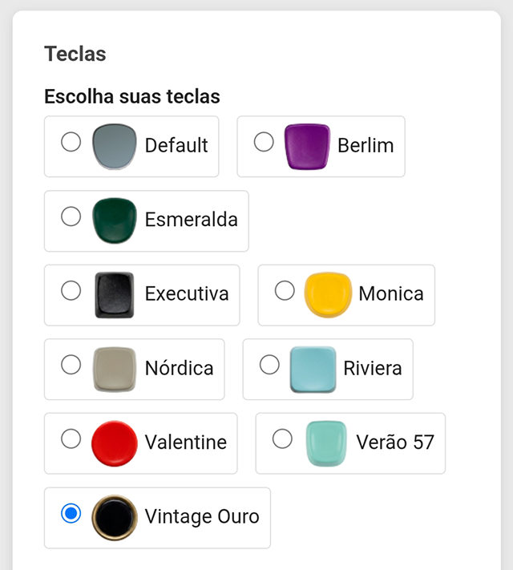

Veja algumas telas de exemplo (prints do iPod):

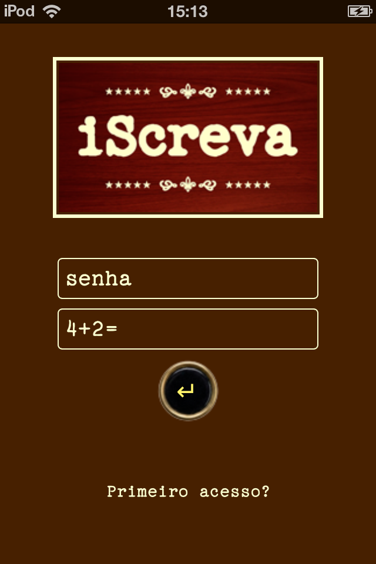
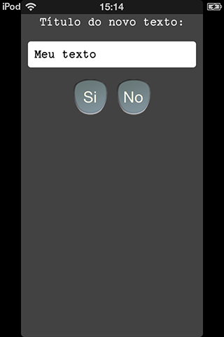
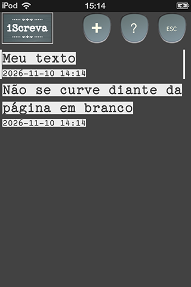
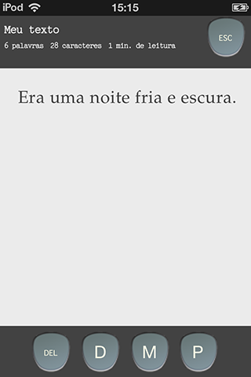
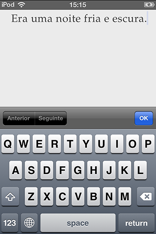
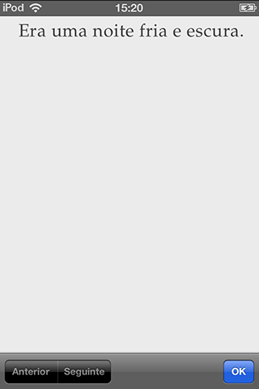
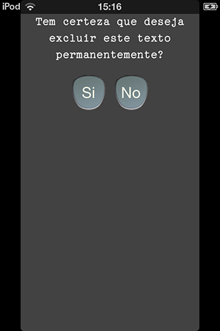
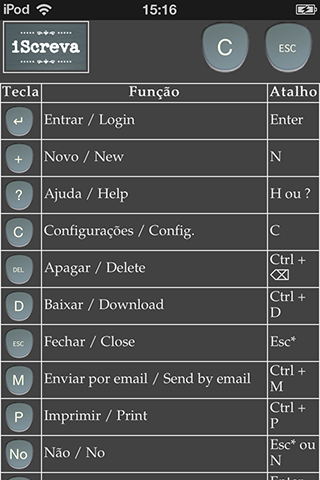
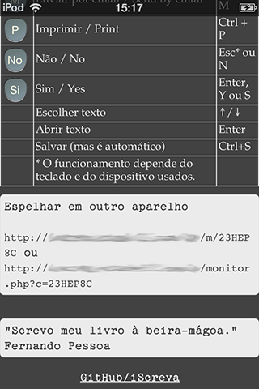

É perfeito para quem tem um iPad, um iPod touch, um Android antigo, um laptop ou qualquer coisa com navegador e tela e quer uma alternativa para escrever sem distrações e sem gastar nada. Basta um espaço mínimo num servidor web (pode ser gratuito, desde que rode _PHP 7+_ e tenha os recursos básicos).

## Como instalar

Coloque a pasta do **iScreva** no diretório público do seu servidor e, para maior segurança, dê outro nome a ela. Acesse o `index.php`. No primeiro acesso, clique no _link_ "Primeiro acesso?" e uma senha será oferecida. Use-a para entrar e vá em Configurações para alterá-la (mínimo de 8 caracteres).

Na primeira execução, serão criados automaticamente quatro arquivos: `iscreva_master_db.php`, `iscreva_master_xxxxxx.db`, `iscreva_conta_xxxxxx.db` e `iscreva_live_xxxxxx.db`.

### Fechar o cadastro

Após criar o seu login, se quiser impedir a criação de outros usuários, abra o `comum.php` e altere a primeira opção para `false`:

```php
define('PERMITIR_CADASTRO', false);
```

### Segurança extra (opcional): bloquear acesso direto aos .db

**Nginx** — coloque estas regras dentro do bloco `server { }`, antes do `location ~ \.php$`:

```nginx
location ~* \.(db|db-journal|db-wal|db-shm)$ { deny all; }
location ~* \.db\.tmp\.[a-f0-9]+$            { deny all; }
location = /iscreva_master_db.php            { deny all; }
```

Depois, valide e recarregue:

```bash
sudo nginx -t && sudo systemctl reload nginx
```

**Apache** — no `.htaccess` (requer Apache 2.4+):

```apache
<FilesMatch "\.(db|db-journal|db-wal|db-shm)$|\.db\.tmp\.[a-f0-9]+$|^iscreva_master_db\.php$">
    Require all denied
</FilesMatch>
```

## Atalhos de teclado

**Na lista de textos**

- `↑` / `↓` — escolher o texto
- `Enter` — abrir o texto escolhido
- `N` — novo texto
- `H` ou `?` — ajuda
- `C` — configurações
- `Esc` — logout\*

**No editor**

- `Ctrl+S` (`Cmd+S` no Mac) — salvar
- `Ctrl+D` — baixar
- `Ctrl+M` — enviar por e-mail
- `Ctrl+P` — imprimir
- `Ctrl+⌫` — apagar o texto
- `Esc` — fechar o editor\*

**Nos avisos de confirmação**

- `S` ou `Y` — sim
- `N` — não
- `Esc` — cancelar\*

\* O comportamento exato da tecla `Esc` pode depender do sistema que você estiver usando.

## Usar um monitor externo

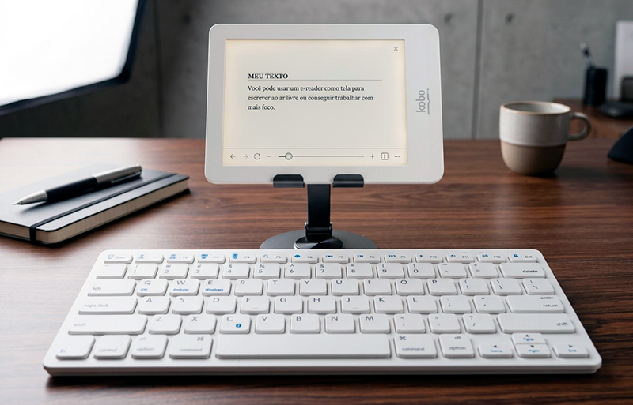

Você pode usar um segundo aparelho — um e-reader, um tablet velho, um monitor externo — para ver o texto que está escrevendo. O editor continua no teclado e no aparelho principal; o segundo apenas exibe o texto. É um recurso particularmente interessante com um e-reader quando você escreve num smartphone cheio de notificações.

Para ativar, vá em **Ajuda** e abra, no outro dispositivo, o endereço que aparece em "Espelhar em outro aparelho". Ele tem a forma curta `https://seu-servidor/m/ABCD234` ou a forma completa `https://seu-servidor/monitor.php?c=ABCD234`.

**Obs.:** a URL curta depende da regra no `.htaccess` que acompanha o projeto. Se o servidor for **Nginx**, acrescente ao bloco `server { }`:

```nginx
rewrite ^/m/([A-Za-z0-9]+)/?$ /monitor.php?c=$1 last;
```
